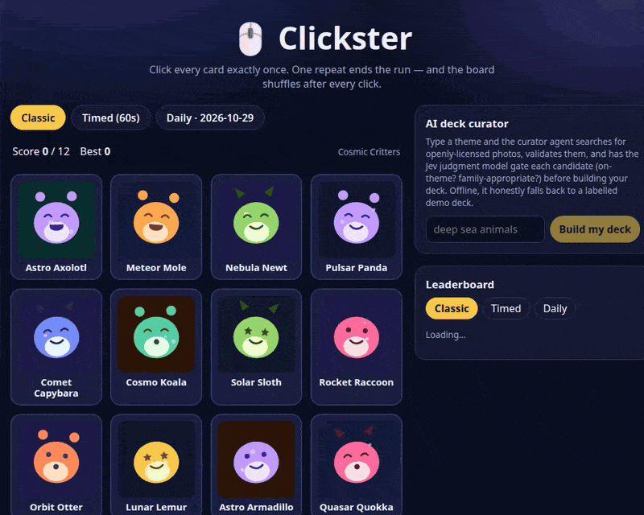
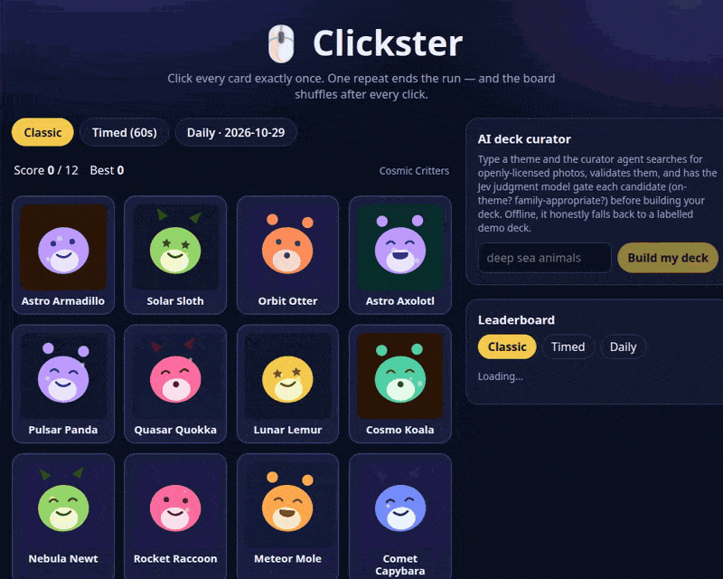
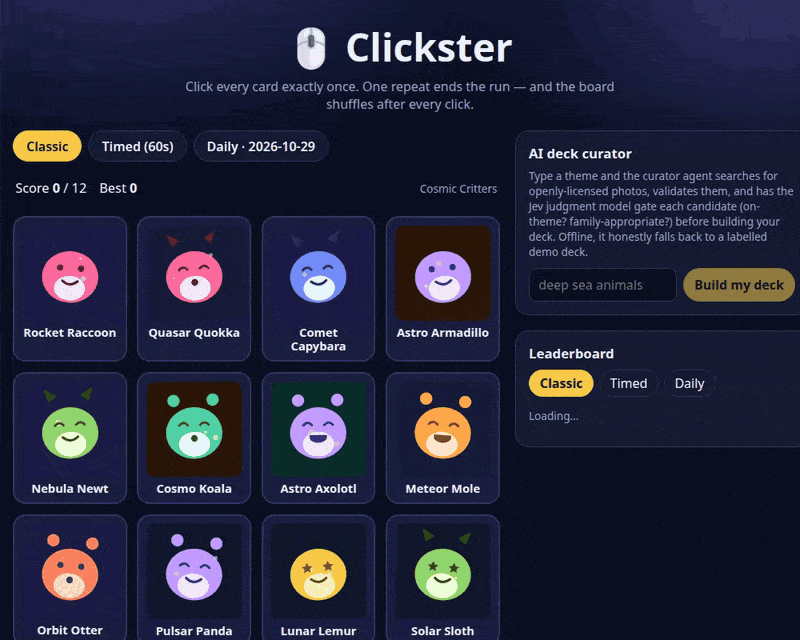

# Clickster — the click-once memory game

A grid of cards is shuffled. Click every card **exactly once**: each click
reshuffles the board, a repeat click ends the run, and clearing the whole
deck wins it. Simple rules, unforgiving memory test.

This is a full rebuild of the original 2019 React/CRA game on a modern
SvelteKit + Cloudflare Workers stack, with three game modes, an AI deck
curator, a judgment-model-gated validation pipeline, an AI host, and a
Redis-backed leaderboard.

## See it in action



*Classic mode — click every card exactly once, the board reshuffles after each click, and the AI host reacts to the run.*



*The deck curator agent — type a theme ("deep sea animals") and watch it search, validate, and assemble a playable deck, streamed step by step. Recorded offline, so it honestly falls back to a labelled demo deck.*



*Bust a run, put your score on the leaderboard, then review your progress: achievements and memory-training stats.*

All three clips are real recordings of the production build running locally in demo mode — no API keys, scripted host, demo judge, in-memory leaderboard.

## How to play

- **Classic** — 12 cards. Click each once; a repeat busts the run.
- **Timed** — same deck against a 60-second clock. The clock wins ties.
- **Daily Challenge** — a 12-card deck dealt from an 18-card pool, seeded
  by the calendar date. Everyone who plays on the same date gets the same
  deck and the same shuffle sequence, and there's a per-date leaderboard.

Extras: streaks, six achievements, a local run history, and a **personal
stats view** (runs over time, win rate, average score, 7-day activity,
daily streak, recent form, and a score trend) — the memory-training angle:
your history is stored locally and the stats are computed from it.

## The AI pieces

### Deck curator agent (`src/lib/server/curator.ts`)

Type a theme — "deep sea animals" — and an agent builds you a playable
deck. It's a real tool loop, streamed step-by-step over SSE:

```
plan → search_images (Openverse) → validate_candidate → assemble_deck
              ↑________ broaden query and retry if short ________|
```

Validation is layered:

1. **Deterministic checks** — license allowlist (CC0 / public-domain mark /
   CC-BY family), dedupe, and the image must actually load.
2. **Jev judgment gate** — each survivor is judged by
   [Jev](https://docs.typesafe.ai) (TypeSafe's System One *judgment*
   model) in one request with three typed questions: a **Noul** for
   "actually about the theme", a **Noul** for "appropriate for a
   family-friendly game", and a **Choice** for fit category. A card joins
   the deck only when both probabilities clear **0.70** and the fit isn't
   "off-theme". The deck carries a summary of how judging went (how many
   judged / accepted, mean confidence, which judge ran).

If live material runs short or the source is unreachable, the curator
falls back to a deck of bundled generated art — labelled `demo` in the UI,
never dressed up as live output.

### AI host (`src/lib/server/host.ts` + `src/lib/server/jev.ts`)

The host reacts to gameplay (streaks, near-misses, wins, busts) in two
layers that are kept separate on purpose:

- **Judgment (Jev)** — Jev does not write text. It picks the reaction:
  a **Choice** over tone (teasing / encouraging / dramatic) and a
  **Score** for how dramatic the moment is (0–1 across a 3-level rubric).
  The UI badge shows the tone and drama score that were picked.
- **Voice** — the actual sentence comes from an adapter: scripted line
  banks (each line tagged with a tone, so Jev's Choice selects among
  them), Gemini, or any OpenAI-compatible endpoint. The scripted host is
  the default and is labelled `demo host (scripted)`.

### Jev without a key: the demo judge

Every Jev call site goes through one helper (`judgeWithFallback`). With
`TYPESAFE_API_KEY` set, the real model answers. Without a key — or if the
API fails — a deterministic **demo judge** (keyword heuristics) answers
instead, and every response, badge, and deck summary names the judge that
actually ran (`typesafe` vs `demo`). Nothing is ever presented as model
output that didn't come from the model.

## Leaderboard (Redis sorted sets)

Scores are stored in **Redis sorted sets** — the canonical fit for a
ranked board: the score *is* the sort key.

- `ZADD clicky:lb:<mode> <score> <member>` — members are JSON
  (`{n: name, s: score, t: timestamp}`); the timestamp makes each member
  unique so equal scores coexist. Daily boards use
  `clicky:lb:daily:<YYYY-MM-DD>`.
- `ZREVRANGE clicky:lb:<mode> 0 49 WITHSCORES` — top 50, best first.

Production store: [Upstash Redis](https://upstash.com) over its REST API
(`src/lib/server/leaderboard.ts`). Without credentials, an in-memory
store mirrors the exact same sorted-set semantics for local/dev/demo —
and every API response says which store served it.

## Stack

| Layer | Choice |
| --- | --- |
| Framework | SvelteKit 3 / Svelte 5 (runes) |
| Language | TypeScript (strict) |
| Runtime / deploy | Cloudflare Workers (`@sveltejs/adapter-cloudflare`) |
| Package manager | Bun (frozen lockfile: `bun.lock`) |
| Lint / format | Biome |
| Unit tests | Vitest (90 tests) |
| E2E tests | Playwright against the production Workers build |
| Dead code | Knip (clean) |
| Judgment model | Jev by TypeSafe (REST, env-gated) |
| Image source | Openverse API (openly licensed, no key) |
| Leaderboard | Upstash Redis REST (sorted sets) + in-memory fallback |

## Architecture sketch

```
src/lib/
  engine.ts          pure game rules (create/apply/timeout) — no I/O
  rng.ts             seeded RNG (mulberry32 + FNV-1a) — deterministic shuffles
  decks.ts           built-in decks + demo-deck builder
  art.ts             deterministic generated SVG card art
  client/
    profile.ts       localStorage profile: bests, achievements, history
    stats.ts         pure stats computation over run history
  server/
    curator.ts       the deck-curator agent loop + Jev gate
    jev.ts           Jev REST client + demo judge + fallback helper
    host.ts          host voices + Jev tone/drama judgment
    leaderboard.ts   Redis sorted-set store + in-memory mirror
    env.ts, fetch.ts runtime plumbing (Workers-safe)
src/routes/
  +page.svelte       the game
  api/comment        POST → host line + judgment
  api/curate         POST → SSE stream of the curator loop
  api/leaderboard    GET top scores / POST a score
```

Game rules are pure functions over an explicit run state; the shuffle
after click *n* derives from `(run seed, n)`. That determinism is what
makes the Daily Challenge identical for everyone and the tests stable —
tests inject fixed dates and seeds everywhere; nothing depends on the
wall clock.

## Local development

```sh
bun install --frozen-lockfile
bun run dev        # vite dev server
bun run preview    # production build under wrangler dev (Workers runtime)
```

With **no environment variables set**, the game runs fully in demo mode:
scripted host, demo judge, generated demo decks when curation can't reach
the live source, and the in-memory leaderboard. Everything below is
optional, env-only, and never committed:

| Variable | Enables |
| --- | --- |
| `TYPESAFE_API_KEY` | Real Jev judgments (curator gate + host tone/drama) |
| `TYPESAFE_MODEL` | Jev model name (default `jev-latest`) |
| `TYPESAFE_BASE_URL` | Jev API base (default `https://api.typesafe.ai`) |
| `GEMINI_API_KEY` / `GEMINI_MODEL` | Gemini host voice |
| `HOST_LLM_BASE_URL` / `HOST_LLM_API_KEY` / `HOST_LLM_MODEL` | OpenAI-compatible host voice |
| `UPSTASH_REDIS_REST_URL` / `UPSTASH_REDIS_REST_TOKEN` | Real Redis leaderboard |

For local Workers dev, copy `.dev.vars.example` to `.dev.vars`.

## Checks

```sh
bun run lint        # biome
bun run typecheck   # svelte-check (strict)
bun run test        # vitest
bun run e2e         # playwright (builds + serves the Workers bundle)
bun run knip        # dead code
bun run deploy:dry  # build + wrangler deploy --dry-run (reports bundle size)
```

CI (`.github/workflows/ci.yml`) runs the same chain plus `bun audit` and
a check that `worker-configuration.d.ts` is fresh.

## Deploy

```sh
bun run build
bun x wrangler deploy
bun x wrangler secret put TYPESAFE_API_KEY        # optional, per variable above
bun x wrangler secret put UPSTASH_REDIS_REST_TOKEN
```

One owner-side verification remains: with a real `TYPESAFE_API_KEY`
deployed, run one curation and one host comment and confirm the badges
read `Jev` (not `Jev demo judge`) — the integration is contract-tested
against mocked responses, and the live key check is deliberately left to
the key holder.
